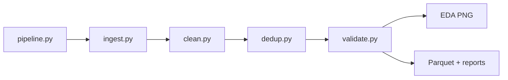

# SK-01 Capstone Project Review

## What you are building

A 10-day “Day 1 integration” HR pipeline for GlobalTech + AcquiredCo. Six deliverables mirror the ShopStream lab in [`sk1-lab/my_pipeline/`](../sk1-lab/my_pipeline/), but for employee data instead of customers:



`pipeline.py` will be the single executable entry point, following the lab pattern. The other modules expose focused functions and do not run the workflow themselves.

| Deliverable | Module / artifact | Lab analog |
|---|---|---|
| 1 Ingestion | `ingest.py` | [`ingest.py`](../sk1-lab/my_pipeline/ingest.py) + pagination pattern |
| 2 Cleaning | `clean.py` | [`clean.py`](../sk1-lab/my_pipeline/clean.py) |
| 3 Dedup | `dedup.py` (separate; lab folds this into clean) | `deduplicate_customers` |
| 4 Validation | `validate.py` + CSV/HTML gate | [`DataQualityValidator`](../sk1-lab/my_pipeline/validate.py) |
| 5 EDA | 6-chart PNG @ 300 DPI | Export/viz step |
| 6 Outputs | Golden Parquet (partitioned), ghost CSV, fuzzy review CSV, README | [`export.py`](../sk1-lab/my_pipeline/export.py) |

**Recommended layout** (mirror the lab): `sk1-capstone/hr_pipeline/` with `config.py`, `pipeline.py`, `ingest.py`, `clean.py`, `dedup.py`, `validate.py`, `visualize.py`, `export.py`, plus `data/raw` (already present) and `data/processed` / `logs`.

Run the complete workflow from the package directory with:

```bash
python3 pipeline.py
```

---

## Raw data inventory (what you actually have)

All four sources exist under [`data/raw/`](data/raw/):

| File | Brief expectation | Actual |
|---|---|---|
| `globaltech_hris.csv` | 15k CSV | **15,000** rows; flat columns; dept **names** not codes |
| `acquiredco_api.json` | 3k paginated JSON | **3,200** employees; nested `name` / `contact` / `assignment` / `employment`; IDs like `ACQ_00001` |
| `payroll_data.xlsx` | 18.5k Excel | **19,000** rows; `source` = GlobalTech \| AcquiredCo; mixed salary strings (`77935`, `$70,315`, `£140,888`) |
| `benefits_enrollment.xml` | 12k XML | **12,000** enrollments; `YYYY-MM-DD` dates (not `DD-Mon-YYYY`) |

---

## Critical brief-vs-data mismatches

Treat the **data as source of truth**; implement the **spirit** of each requirement and document assumptions in the README.

1. **Department taxonomy** — Brief says GlobalTech uses codes (`ENG-01`) and AcquiredCo uses names. Both sources already use the **same 18 English department names**. Mapping is still required (identity map + log unknowns), but you will not see code→name conversion in this dataset.

2. **Date formats** — Brief lists three formats. Reality:
   - GlobalTech: `YYYY-MM-DD` (matches)
   - AcquiredCo: ISO timestamps (`2024-06-27T00:00:00`), not `MM/DD/YYYY`
   - Benefits: `YYYY-MM-DD`, not `DD-Mon-YYYY`
   - Still parse defensively with multiple formatters so the graded skills are demonstrated.

3. **Employee ID overlap** — Brief implies bare overlapping numbers (`1042`). GlobalTech is `1..15000`; AcquiredCo is `ACQ_NNNNN` whose numeric part **does** overlap `1..3000`. Namespacing to `GT-001042` / `AC-001042` is still correct; strip `ACQ_` when building `AC-######`. Payroll IDs are already split by `source` (numeric vs `ACQ_*`).

4. **Employment type** — Validation expects `{Full-Time, Part-Time, Contractor}`. AcquiredCo uses `{FT, PT, CONTRACTOR}` — map in `clean.py` before validation.

5. **Currency / salary** — Currencies are USD/EUR/GBP as stated. Salaries are mixed: plain numbers, `$`-prefixed, and `£`-prefixed with commas. Cleaning must strip currency symbols, not only `$`.

6. **Email cross-match (Pass 2)** — Current email overlap between HRIS sources is **0**. Still implement the pass; expect empty or rare matches. Fuzzy pass (Pass 3) is where cross-company collisions are more likely.

7. **Validation gate** — Capstone: halt if **>2 checks FAIL**. Lab: per-check pass-rate threshold (default 95%). Reuse `DataQualityValidator` methods, but change the overall gate to the “count of FAILs” rule.

8. **Volume deltas** — Brief vs files differ slightly (3k→3.2k, 18.5k→19k). Use actual counts in logs/README; do not hardcode brief numbers.

---

## Deliverable-by-deliverable notes

### 1 — Ingest
- Four loaders + `align_to_standard_schema(...)` with documented column maps.
- Simulate pagination on AcquiredCo (e.g. page size 100 over the in-file `employees` list) like the CRM pattern in the lab.
- Parse XML with `ElementTree`; one row per enrollment (note: multiple plans per employee → enrollment grain, not employee grain — decide whether to pivot/aggregate before join or attach as benefits flags).
- Dead-letter: missing/malformed rows → log + skip, never crash.

**Standard schema suggestion** (align all sources then union):
`employee_id`, `first_name`, `last_name`, `email`, `department`, `job_title`, `hire_date`, `country`, `employment_type`, `manager_id`, `company_origin`, `source_system`, plus payroll/benefits fields when present (`base_salary`, `currency`, `pay_frequency`, `plan_type`, `enrollment_date`, …).

### 2 — Clean
- Names: Unicode NFKC + title case; preserve hyphens / apostrophes / particles.
- IDs → `GT-######` / `AC-######`.
- FX table (document rates) → `salary_usd_annual`; keep originals; Annual / Monthly×12 / Bi-Weekly×26.
- Dept map + unmapped log.
- Dates → `datetime64[ns]` + out-of-range flags.

### 3 — Dedup
- Pass 1: exact namespaced ID; priority **HRIS > Payroll > Benefits**.
- Pass 2: email across companies.
- Pass 3: `rapidfuzz` ≥ 88% on first+last, hire-date block ±30 days → `probable_match` review file (do not auto-merge).
- Ghosts: payroll with no HRIS counterpart → separate CSV.
- Provenance: `source_systems`, `dedup_method`.

### 4 — Validate (≥12 checks)
Reuse lab class; cover the table in the brief (NOT NULL ×6 fields, UNIQUE email/id, VALUES IN SET, REGEX email + ID, salary range, hire_date range, manager referential integrity). Export CSV + HTML; gate on >2 FAILs.

### 5 — EDA
Six charts in one figure (or tightly composed multi-panel), colorblind-safe, titles/labels/source annotation, overall title + timestamp, save **≥300 DPI PNG**.

### 6 — Golden outputs
- Parquet partitioned by `company_origin`.
- Schema doc (in README or `docs/schema.md`).
- Ghost + probable-match CSVs with required columns.
- Full README (purpose, I/O, how to run, limitations, changelog).

---

## Pipeline orchestration

`pipeline.py` will define `run_pipeline()` and coordinate every stage in order:

1. Initialize logging and verify all four raw input files.
2. Call `ingest_all_sources()` and retain the separate source DataFrames needed for joins and source-specific rules.
3. Call the cleaning functions to normalize names, IDs, employment types, departments, dates, and salaries.
4. Aggregate benefits to employee grain, then call the deduplication workflow.
5. Produce the ghost employee and probable fuzzy-match DataFrames.
6. Run all data-quality checks.
7. If more than two checks fail, log a critical error, export the validation report, and stop before publishing the golden dataset.
8. If the quality gate passes, generate the six-chart EDA report and export every final artifact.
9. Log input/output counts, duplicate counts, ghost counts, probable-match counts, validation results, output paths, and total runtime.

The module boundary will follow the same pattern as [`../sk1-lab/my_pipeline/pipeline.py`](../sk1-lab/my_pipeline/pipeline.py): orchestration remains in `pipeline.py`, while transformation logic stays testable in its owning module.

---

## Suggested implementation order

1. Scaffold package + `config.py` (paths, FX rates, dept map, source priority, regexes).
2. `ingest.py` → inspect row counts / schemas in logs.
3. `clean.py` (IDs, names, currency, dates, dept, employment_type).
4. `dedup.py` + ghost / review outputs.
5. `validate.py` + gate.
6. `visualize.py` + `export.py`.
7. `pipeline.py` as the single entry point that triggers all stages, followed by end-to-end verification and README documentation.

Reuse patterns from the lab; split dedup into its own module because the brief grades it separately.

---

## Open decision (confirm before build)

**Benefits grain:** XML has ~12k enrollment rows (multiple plan types per employee). For the golden **employee** dataset, aggregate to one row per employee (e.g. enrolled flag + list/count of plans) rather than exploding headcount. Benefits enrollment rate chart then uses that employee-level flag by department.
