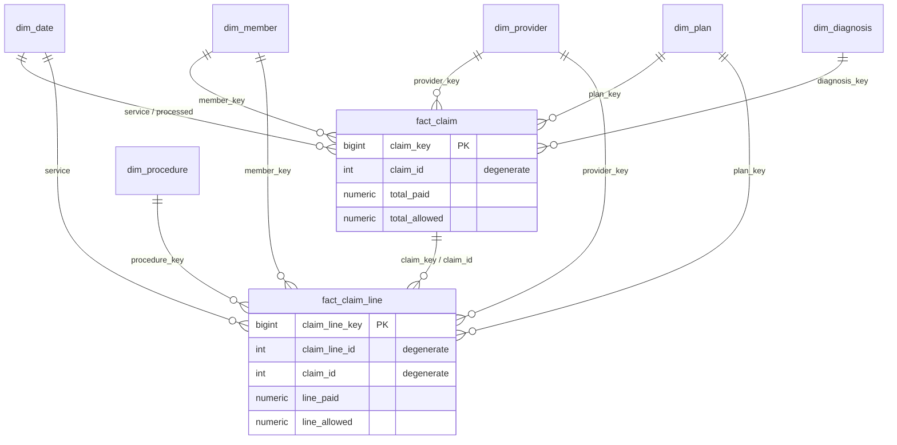

# MedInsure Dimensional Model Design

**Deliverable 1** — design locked before any warehouse DDL.  
Database: `medinsure` · Warehouse schema: `dw`  
Related: [`PLAN.md`](../PLAN.md) · [`SK-02_Capstone_Project.md`](../SK-02_Capstone_Project.md)

---

## 1. Business process

**Process:** healthcare medical claims adjudication and payment for MedInsure members.

Analysts need fast answers for provider performance, member utilization, diagnosis-category spend, denial rates, in- vs out-of-network cost, trends, enrollment cohorts, and year-to-date provider spend — without querying the live OLTP claims system.

---

## 2. Grain declarations

| Fact table | Grain (one sentence) |
|---|---|
| `fact_claim` | **One row per adjudicated claim header** (one visit/encounter bill). |
| `fact_claim_line` | **One row per service line within a claim** (one billed procedure/service on that bill). |

**Fanout rule:** never join `fact_claim_line` into a header-grain spend query without aggregating lines first. Header money lives on `fact_claim`; line money lives on `fact_claim_line`.

---

## 3. Star schema overview



Header star answers most contract and finance questions. Line star supports procedure-level detail and orphan-procedure quality checks.

---

## 4. Fact table classification

| Fact | Type | Justification |
|---|---|---|
| `fact_claim` | **Transaction** | Each row is a point-in-time adjudication event: amounts are fixed when the claim is processed. Not a period-end balance (periodic snapshot) and not a pipeline row that advances through milestones (accumulating snapshot). |
| `fact_claim_line` | **Transaction** | Each row is one billed service on that claim at adjudication time. Same rationale as the header. |

---

## 5. Dimensions

| Dimension | SCD | Tracked / notable attributes | Justification |
|---|---|---|---|
| `dim_date` | N/A (static calendar) | `date_key` (YYYYMMDD), year, quarter, month, day names, weekend flag | Role-playing date dimension for service and processed dates. Populated once via `GENERATE_SERIES` for 2020–2030. No fiscal calendar. |
| `dim_member` | **Type 2** | Natural: `member_id`. SCD2: `plan_id`, `state`, `zip_code`. Also: demographics, `enrollment_date`. Columns: `effective_start`, `effective_end`, `is_current` | Compliance needs multi-year history of plan and geo changes. Type 2 preserves “as of service date” membership. |
| `dim_provider` | **Type 2** | Natural: `provider_id`. SCD2: `network_status`, `specialty`. Also: name, `network_effective_date`. Same effective-date columns | Network and specialty at time of care drive OON cost and denial analysis; history must not be overwritten. |
| `dim_diagnosis` | **Type 1** | Natural: ICD-10 code; description; category | Codes rarely change; overwriting description/category is acceptable. |
| `dim_procedure` | **Type 1** | Natural: CPT code; description; category | Same as diagnosis — reference data, Type 1 UPSERT. |
| `dim_plan` | **Type 1** | Natural: `plan_id`; plan type name (HMO/PPO/…); deductible; OOP max | Plan catalog attributes treated as current; member↔plan history lives on `dim_member` (Type 2), not here. |

### SCD Type 2 dating convention (locked)

Inclusive end date for all history lookups:

```text
effective_start <= service_date <= effective_end
```

Current versions use `effective_end = '9999-12-31'` and `is_current = TRUE`.

### Not Applicable (NA) placeholder rows

Every dimension that can appear as an **optional** fact FK gets a surrogate key `0` “Not Applicable” row (e.g. missing primary diagnosis).  
**Required** keys (`member_key`, `provider_key`, date keys) do **not** use NA for “not found” — unmatched member/provider claims are **dead-lettered and skipped** at ETL time.

---

## 6. Conformed dimensions

A **conformed dimension** is defined once and reused by multiple fact tables so metrics stay consistent across subject areas.

| Dimension | Conformed for | Why |
|---|---|---|
| **`dim_member` (primary)** | Future `fact_pharmacy` + current claim facts | Same insured person across medical and pharmacy; one member spine for utilization and compliance |
| `dim_date` | Any future fact | Shared calendar |
| `dim_plan` | Pharmacy / medical | Same benefit plans |
| `dim_provider` | Pharmacy (prescriber) / medical | Shared provider identity where applicable |

**Declared conformed dimension for the brief:** `dim_member`.

---

## 7. Degenerate dimensions

| Attribute | Lives on | Role |
|---|---|---|
| `claim_id` | `fact_claim` and `fact_claim_line` | Source natural claim ID; links lines to headers without a `dim_claim` table |
| `claim_line_id` | `fact_claim_line` | Source line ID; idempotency key for incremental loads (`ON CONFLICT DO NOTHING`) |

No separate dimension tables for these — they are transaction identifiers, not rich descriptive entities.

---

## 8. Planned column sketch (logical)

Column lists are inferred from analytics and quality requirements. Physical types come in Deliverable 2 DDL.

### `fact_claim` (header)

| Column | Role |
|---|---|
| `claim_key` | Surrogate PK |
| `claim_id` | Degenerate / natural unique |
| `service_date_key` | FK → `dim_date` (when care occurred) |
| `processed_date_key` | FK → `dim_date` (when adjudicated; HWM source) |
| `member_key` | FK → `dim_member` (SCD2 version as of service date) |
| `provider_key` | FK → `dim_provider` (SCD2 version as of service date) |
| `diagnosis_key` | FK → `dim_diagnosis` (from `claims.primary_diagnosis_code`; NA=0 if missing) |
| `plan_key` | FK → `dim_plan` (plan in force on the member version / claim) |
| `claim_type` | Degenerate-style attribute (e.g. professional / institutional) |
| `claim_status` | e.g. paid / denied / partial |
| `total_allowed`, `total_paid` | Measures |

### `fact_claim_line` (line)

| Column | Role |
|---|---|
| `claim_line_key` | Surrogate PK |
| `claim_line_id` | Degenerate / natural unique |
| `claim_key` | FK → `fact_claim` |
| `claim_id` | Degenerate (denormalized link to header natural key) |
| `service_date_key` | FK → `dim_date` |
| `member_key`, `provider_key`, `plan_key` | Conformed FKs (same versions as header where applicable) |
| `procedure_key` | FK → `dim_procedure` (NA=0 if missing) |
| `line_number` | Optional ordering within claim |
| `line_allowed`, `line_paid` | Measures |

### SCD2 dimension extras

| Table | Natural key | Type 2 attributes | Control columns |
|---|---|---|---|
| `dim_member` | `member_id` | `plan_id`, `state`, `zip_code` | `effective_start`, `effective_end`, `is_current` |
| `dim_provider` | `provider_id` | `network_status`, `specialty` | same |

Primary diagnosis is **on the claim header only** (locked). Procedure codes live on **lines**.

---

## 9. Source → warehouse mapping (summary)

| OLTP source | Warehouse target |
|---|---|
| `plan_types` | `dim_plan` (Type 1) |
| `diagnosis_codes` | `dim_diagnosis` (Type 1) |
| `procedure_codes` | `dim_procedure` (Type 1) |
| `members` + `member_plan_history` | `dim_member` (Type 2) |
| `providers` + `provider_network_history` | `dim_provider` (Type 2) |
| Calendar (generated) | `dim_date` |
| `claims` | `fact_claim` |
| `claim_lines` | `fact_claim_line` (after headers) |

ETL details (close-then-insert, HWM, dead letter) are Deliverable 3; this document only locks the *model*.

---

## 10. Dry-run queries (prove the model on paper)

These sketches show the star can answer the three painful OLTP questions without 3NF gymnastics.

### A. Provider performance (paid by provider, recent period)

```sql
-- Business: total paid by provider for contract review
SELECT
    p.provider_id,
    p.provider_name,
    p.specialty,
    p.network_status,          -- as stored on the SCD2 version linked to the claim
    SUM(f.total_paid) AS total_paid
FROM dw.fact_claim f
JOIN dw.dim_provider p ON p.provider_key = f.provider_key
JOIN dw.dim_date d ON d.date_key = f.service_date_key
WHERE d.year = 2025 AND d.month = 6
GROUP BY p.provider_id, p.provider_name, p.specialty, p.network_status
ORDER BY total_paid DESC;
```

### B. Member utilization by plan type

```sql
-- Business: claims activity sliced by plan type (warehouse avoids crashing OLTP)
SELECT
    pl.plan_type,
    d.year,
    d.month,
    COUNT(*) AS claim_count
FROM dw.fact_claim f
JOIN dw.dim_plan pl ON pl.plan_key = f.plan_key
JOIN dw.dim_date d ON d.date_key = f.service_date_key
GROUP BY pl.plan_type, d.year, d.month;
```

### C. Paid by diagnosis category

```sql
-- Business: what did we pay per diagnosis category?
SELECT
    diag.category,
    SUM(f.total_paid) AS total_paid
FROM dw.fact_claim f
JOIN dw.dim_diagnosis diag ON diag.diagnosis_key = f.diagnosis_key
JOIN dw.dim_date d ON d.date_key = f.service_date_key
WHERE d.year = 2025 AND d.quarter = 2
  AND diag.diagnosis_key <> 0   -- exclude NA if desired
GROUP BY diag.category
ORDER BY total_paid DESC;
```

---

## 11. Design decisions checklist (brief coverage)

| Requirement | Decision |
|---|---|
| Grain for both facts | Declared in §2 |
| SCD type per dimension | Declared in §5 |
| Fact type classification | Both **transaction** — §4 |
| Conformed dimension | **`dim_member`** (also date/plan/provider) — §6 |
| Degenerate dimensions | `claim_id`, `claim_line_id` — §7 |
| Primary diagnosis | On header → `fact_claim.diagnosis_key` |
| Unmatched member/provider | Dead-letter + skip (not NA keys) |
| SCD date range | Inclusive end |
| Multiple dates on facts | `service_date_key` + `processed_date_key` |

---

## 12. Next step

**Deliverable 2:** implement `sql/01_oltp.sql` (source + full-volume seed) and `sql/02_dw_ddl.sql` (physical CREATE TABLE statements matching this design).
