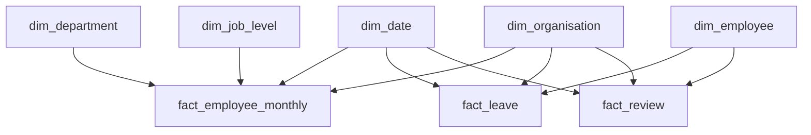

# CloudHR data model

One Import-mode model serves all 200 organisations. Row-level security filters `dim_organisation` by the signed-in employee's organisation, and `dim_department` by that organisation or by one department when the employee is below M1. The organisation filter reaches each fact through the relationships below. The department filter reaches `fact_employee_monthly`. Delete every relationship Power BI creates on its own, then create only the pairs in the relationship table. Each one is many-to-one, active, and filters in a single direction: from the dimension to the fact.

`first_name` and `last_name` do not enter the model. Analytics uses `employee_id`. The work email lives only on `security_users`.

## Grain

- `fact_employee_monthly`: one row per employee per month.
- `fact_leave`: one row per leave instance.
- `fact_review`: one row per employee per review year.

`employees` is the current person record, and it is not a fact. It has no month, so it cannot trend headcount. A hire or a termination is a date on the person, not a balance that can be counted at month-end. Monthly history of department, job level, salary, and the active flag lives on `employee_monthly_snapshots`, and that table becomes `fact_employee_monthly`.

`dim_employee` is a browse list of current staff: `termination_date` is null, and the latest snapshot has `is_active`. People who have left are absent from it. They remain in older snapshots through `org_id` on `fact_employee_monthly`.

## Headcount is semi-additive

Headcount adds across departments and across organisations. It does not add across months. A person who worked all of Q1 appears on the January, February, and March snapshots. Adding those three rows counts that person three times.

`Active Headcount` and `Headcount EOP` count the snapshot on the last date in the filter. For a Q1 slicer that last date is 31 March, so Q1 headcount is the March snapshot. `Headcount BOP` counts the first date in the filter. Turnover divides terminations by the average of those two end-points.

The Q1 control totals below are the check. March is the figure the measure must match. The Jan+Feb+Mar sum is the figure it must reject.

## Relationships

`DateKey` is an integer `YYYYMMDD` on every fact and on `dim_date`. The relationship uses `DateKey`. Mark `dim_date` as the date table on `Date`.

| Many (fact) | One (dimension) | What the key means |
|---|---|---|
| `fact_employee_monthly[DateKey]` | `dim_date[DateKey]` | Last day of `snapshot_month` |
| `fact_employee_monthly[department_id]` | `dim_department[department_id]` | Department in that month |
| `fact_employee_monthly[job_level]` | `dim_job_level[job_level]` | Job level in that month |
| `fact_employee_monthly[org_id]` | `dim_organisation[org_id]` | Organisation in that month, including people who have since left |
| `fact_leave[DateKey]` | `dim_date[DateKey]` | `start_date` of the leave |
| `fact_leave[org_id]` | `dim_organisation[org_id]` | Organisation on the leave |
| `fact_leave[employee_id]` | `dim_employee[employee_id]` | Current employee attributes |
| `fact_review[DateKey]` | `dim_date[DateKey]` | 1 January of `review_year` |
| `fact_review[org_id]` | `dim_organisation[org_id]` | Organisation on the review |
| `fact_review[employee_id]` | `dim_employee[employee_id]` | Current employee attributes |

`department_id` is unique across organisations. `job_level` values, from most junior to most senior, are IC1, IC2, IC3, IC4, M1, M2, M3. `dim_department` carries `department_group`.

### Do not create these relationships

- `dim_department` to `dim_organisation`. The department on the snapshot already carries the month's department, and the snapshot carries its own `org_id`. A second path from organisation to the workforce fact is ambiguous.
- `dim_employee` to `dim_organisation`. The employee dimension is current staff only. An organisation filter that reached the snapshot only through that dimension would drop people who have left.
- `fact_employee_monthly[employee_id]` to `dim_employee[employee_id]`. Historical headcount uses the organisation, department, and job level on the snapshot.
- `dim_department` to `dim_job_level`.
- Any relationship between `fact_employee_monthly`, `fact_leave`, and `fact_review`.
- `leave_entitlement` to any table. The utilization measure looks up the allowance by leave type.
- `security_users` to any table. The role reads it with `LOOKUPVALUE`. Hide it in report view. Do not load `security_mapping`.
- `salary_errors` to any table. It holds the quarantined non-positive salary rows. Hide it in report view.

## Star

Filter direction runs from the dimension to the fact. `leave_entitlement`, `security_users`, and `salary_errors` sit outside this diagram and have no lines.

## Department and job level

At one snapshot an employee has one department and one job level. Both columns are foreign keys on `fact_employee_monthly`. A bridge would be required only if one snapshot row belonged to several departments or several levels. The two dimensions are not related to each other.

## Calendar

HR totals reset on 1 January, so `dim_date` is a calendar year and `DATESYTD` takes no year-end argument. A fiscal argument such as `"6/30"` would move year-to-date off the calendar year these metrics use.

The table runs from 1 January 2022 through 30 September 2026. The first snapshot is January 2023, so the extra year gives year-over-year a prior period. The last snapshot date is 30 September 2026, the last closed month. The table stops there, so a 2026 selection covers January through September and does not invent October, November, or December.

Columns: `DateKey`, `Date`, `Year`, `Month Number`, `Month Name`, `Quarter`, `Day of Week`, `Is Weekend`, `Is Holiday` (US federal), `Week Number`. Sort `Month Name` by `Month Number`. Mark the table as a date table on `Date`.

## Leave allowance

The source does not store an allowance. `leave_entitlement` is a four-row reference table created in Power Query:

| Leave type | Days per year |
|---|---:|
| Annual | 20 |
| Sick | 10 |
| Parental | 60 |
| Other | 5 |

Leave utilization divides days taken in the selected period by that allowance.

## Control totals

Computed in Postgres by `sql/controls.sql` after `sql/01_create_and_load_cloudhr.sql`, on database `cloudhr`. Year Y is **2025**, the latest full calendar year. December of Y is the snapshot whose `snapshot_month` is `2025-12-01`. Power Query turns that into the month-end date key 31 December 2025. September 2026 is the current month-end in the file, and it is not used as year Y.

Organisation 1 is Apex Analytics. The same queries are repeated with no organisation filter for the whole database. Active headcount is `COUNT(*)` of snapshot rows with `is_active` for that one month.

The figures include the planted bad rows. Hires and terminations count whatever `hire_date` or `termination_date` falls in 2025, including a hire date that is after the termination date.

### Active headcount, December 2025

| Scope | Active headcount |
|---|---:|
| Organisation 1 | 38 |
| Whole database | 35,882 |

Organisation 1 has 50 rows on `employees`. Twelve of those people are not active on the December snapshot.

### Q1 2025 headcount

Q1 headcount is the March snapshot. The Jan+Feb+Mar sum counts a person who worked the whole quarter three times. The headcount measures have to match March and reject the sum.

| Scope | March snapshot (correct) | Jan + Feb + Mar (incorrect) |
|---|---:|---:|
| Organisation 1 | 38 | 112 |
| Whole database | 33,264 | 98,856 |

### Hires in 2025

`hire_date` on or after 1 January 2025 and before 1 January 2026.

| Scope | Hires |
|---|---:|
| Organisation 1 | 4 |
| Whole database | 5,730 |

### Terminations in 2025

`termination_date` on or after 1 January 2025 and before 1 January 2026. Voluntary is `termination_reason = 'Voluntary'`. Every other reason in that year is the other group.

| Scope | Voluntary | Other | Total |
|---|---:|---:|---:|
| Organisation 1 | 1 | 1 | 2 |
| Whole database | 1,270 | 830 | 2,100 |

### Average base salary, December 2025

`AVG(base_salary_usd)` on the December snapshot, ignoring nulls and values less than or equal to zero. Inactive rows have a null salary, so they drop out. Eight active rows in the whole database have a non-positive salary and are excluded (35,882 active rows, 35,874 rows in the average). Organisation 1 has no non-positive salary in that month, so all 38 active rows are in its average.

| Scope | Rows in the average | Average base salary (USD) |
|---|---:|---:|
| Organisation 1 | 38 | 92,754.005789473684 |
| Whole database | 35,874 | 102,809.639137815688 |

Shown as currency to the cent, those averages are $92,754.01 and $102,809.64. The control total is the exact average above.

### Leave days in 2025

Sum of `days_taken` by leave type, for leave whose `start_date` falls in 2025. A leave is dated by its start, which is the date key on `fact_leave`, so days that run past 31 December still count in 2025 when the leave started in 2025.

| Leave type | Organisation 1 | Whole database |
|---|---:|---:|
| Annual | 476 | 453,734 |
| Sick | 68 | 66,904 |
| Parental | 68 | 44,345 |
| Other | 10 | 9,041 |
| Total | 622 | 574,024 |

## Power Query row counts

Loaded tables after the queries in `docs/m_code.md`. `workforce_base` is not loaded.

| Table | Rows |
|---|---:|
| `dim_organisation` | 200 |
| `dim_department` | 1,120 |
| `dim_employee` | 37,051 |
| `dim_job_level` | 7 |
| `dim_date` | 1,734 |
| `fact_employee_monthly` | 2,118,915 |
| `salary_errors` | 32 |
| `fact_leave` | 333,300 |
| `fact_review` | 96,081 |
| `leave_entitlement` | 4 |
| `security_users` | 37,051 |
